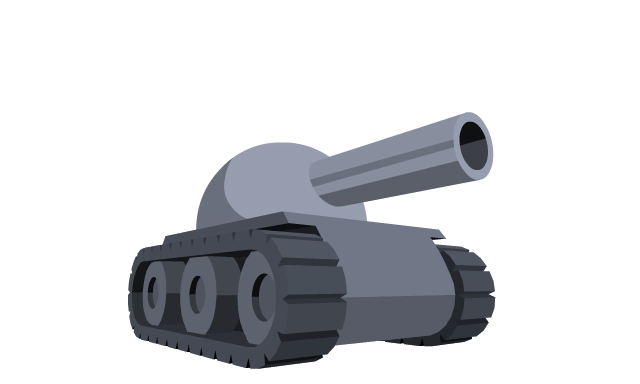
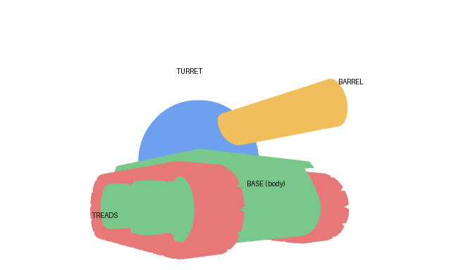

# Helping with accessories

Thanks for wanting to help! Color Lab's accessories could always look better. A lot of the current artwork was made with AI, so improved versions and brand-new ideas are both welcome.

## What you can make

- **New accessories:** hats, glasses, things on the back, barrel items, front badges and auras.
- **Fixes:** a better version of an existing item that doesn't sit right on the tank.

Accessories show on the **tank picture**: the big tank in the garage and on the menu, seen from the front-left at a slight angle. They don't show on the small tank in the maze, so they only need to look good on the tank template below.

## The tank template

Draw on this tank. It's the exact size and position the game uses for its tank pictures, so anything drawn on it lines up perfectly.

_Right-click the picture and choose "Save image as" to download it (640 × 384 pixels)._

This version shows which part is which, so you know where items go:

| Part            | Colour above | What goes there                                |
| --------------- | ------------ | ---------------------------------------------- |
| **Turret**      | blue         | hats, glasses, helmets (the round dome on top) |
| **Barrel**      | yellow       | barrel items, things hanging from it           |
| **Base** (body) | green        | front badges, chains, decals                   |
| **Treads**      | red          | the tracks on each side                        |

## Size

- **640 × 384 pixels**, or bigger at the same shape (for example 1280 × 768).
- Drawn on the tank template, with the tank in the same position.
- A transparent PNG is best; a plain white background also works.

In the template, the tank fills roughly **x 128–495** and **y 112–368** (from the top-left corner). Leave space around it for anything that sticks out: tall hats above the turret, flags and banners above the back, and items hanging below the barrel.

## Tips

- **Draw the item on the [tank template](#the-tank-template)**, without moving or resizing the tank, so it lines up exactly.
- **Plain white background**, nothing touching the edges. For glowing items or auras, plain black works better.
- **Keep it where it belongs:**
  - **Top:** sits on the round turret dome.
  - **Back:** behind the turret, at the opposite end from the barrel (the left side of the picture).
  - **Front:** on the flat front face of the hull.
  - **Barrel:** on or around the barrel.
- **Leave the tank itself unchanged.** Only the item is cut out and kept, so it doesn't matter if your drawing of the tank is rough.
- **No text or logos.** If an item needs words (a banner, a calendar), leave it blank and say what it should say. The lettering is added afterwards so it stays sharp.
- One picture is enough for an item that should come in several colours; the other colours can be made from it.

## Using AI to make it

AI image tools work well if you give them the tank to draw on:

1. Attach the [tank template](#the-tank-template) picture.
2. Describe the item and exactly where it goes (see "Keep it where it belongs" above). Saying "the LEFT side of the picture, behind the turret" helps for back items; otherwise tools often put them on the front.
3. End the prompt with something like: _"Keep the tank exactly the same as the attached picture: same colours, same angle, same size and position. Only add the item described. Plain pure white background, no ground shadow, cartoon game style with clean dark outlines and soft shading, no text, no logos."_

## Please keep it original

- **No copyrighted characters, brands, logos or signature designs.** A "spy" theme is fine; a copy of a specific film or game character is not. A sneaker is fine; a real brand's logo on it is not.
- No real people.
- Nothing offensive or inappropriate for a game played by all ages.

## How to send it

Reply on the forum thread, or open an [issue](https://github.com/wazzey/tanktrouble-color-lab/issues) on GitHub, with:

- your picture (PNG or JPG);
- what it is and where it goes (top, back, front, barrel or aura);
- which box it fits, if you have one in mind.

By sending artwork, you agree it can be used, edited and recoloured in Color Lab, and you'll be credited in the README if you'd like. Color Lab is free and not for profit, so there's no payment.

Thanks for helping!
