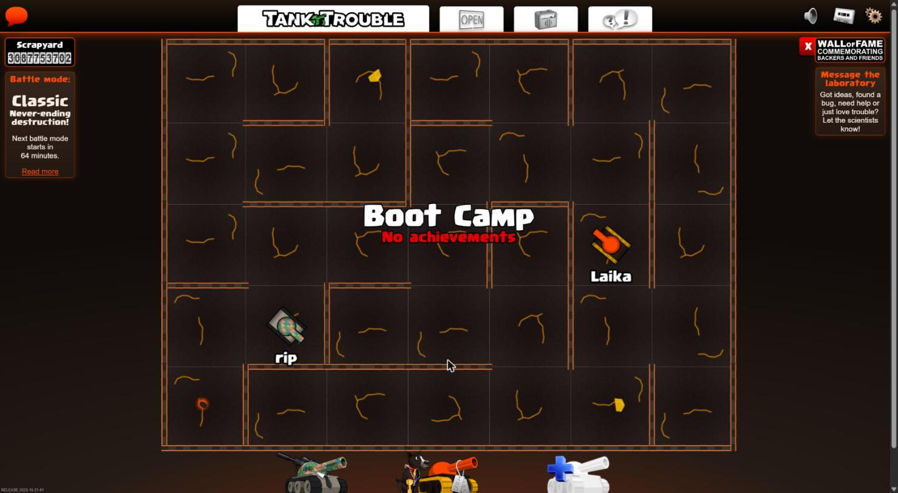
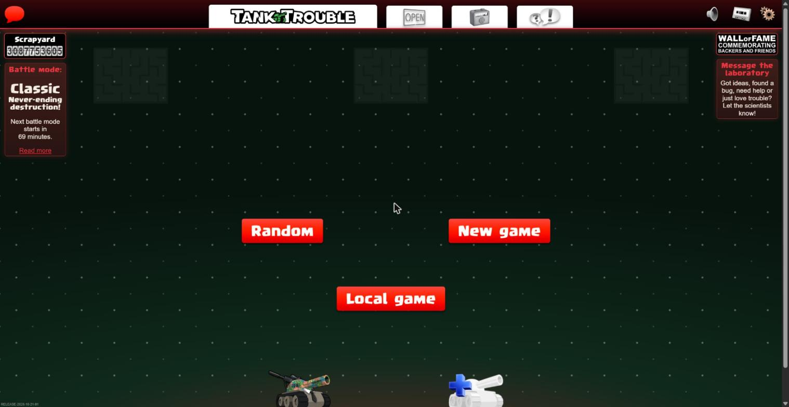
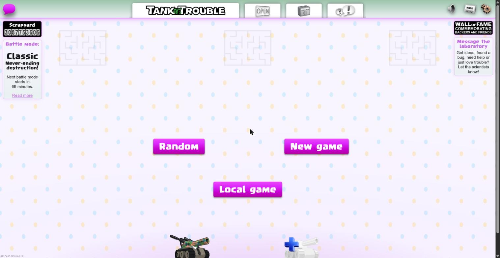
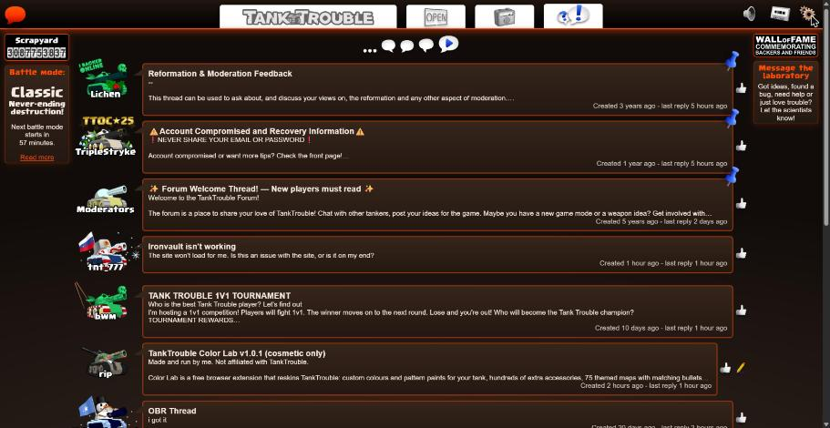

# TankTrouble Color Lab

**Custom colours, paints, items, map themes and page themes for TankTrouble.** 
Cosmetic only · Free · No ads · No account

[**Install**](#install) · [**What's new**](#whats-new-in-v143) · [**Features**](#features) · [**Screenshots**](#screenshots) · [**FAQ**](#faq) · [**Privacy**](#privacy) · [**Changelog**](CHANGELOG.md)

> Made and run by **wazzey**. **Not affiliated with TankTrouble.** An independent, fan-made extension that changes how the game looks on your own screen. It gives no advantage in the game. Only you and other Color Lab users see your looks; everyone else sees the normal game.

---

## What's new in v1.4.3

- 🏷 **Color Lab badges** sit neatly on the forum and show in a tank's profile box.
- 🛒 GitHub copies will show how to move to the Chrome Web Store as soon as it's live.

**Also new since v1.4.1:**

- 💾 **Looks**: a **💾 Looks** button in the garage switches your tank between saved looks in one click; **+ New look** starts another.
- ✅ **Clearer saving**: Save shows **✓ Saved** until something changes, and the same look can't be saved twice.
- 🌙 **Dark** page theme for the site, forum, news and shop.
- 🏆 **Achievements** are no longer secret: every name and goal is shown.
- 🟢 **Online list** shows who's idle and whether they're in the lobby, a queue or a game.
- 🕶 **Incognito** windows: Color Lab works, but stays offline.
- 🔧 Fixes for the Streetwear items and the "connecting" text on dark themes, plus a new icon.

🛒 **Coming soon to the Chrome Web Store**: one-click install and automatic updates. [Full changelog →](CHANGELOG.md)

---

## Install

### Chrome Web Store (recommended)

Installs in one click and **updates by itself**. The listing is being reviewed; the **Add to Chrome** link will be here as soon as it's approved.

### From GitHub (available now)

1. Download `TankTrouble-Color-Lab-v1.4.3.zip` from the [**latest release**](https://github.com/wazzey/tanktrouble-color-lab/releases/latest) (not the `-webstore` zip, and not "Source code").
2. Unzip it and keep the `TankTrouble-Color-Lab` folder somewhere safe. The browser runs it from there.
3. Open `chrome://extensions` (or `brave://extensions`, `edge://extensions`) and turn on **Developer mode**.
4. Click **Load unpacked** and choose the `TankTrouble-Color-Lab` folder.
5. Open tanktrouble.com and press **Alt+C** (**Option+C** on a Mac).

A short tutorial starts the first time. A copy installed this way doesn't update by itself: Color Lab tells you when a new version is out.

**Updating:** copy the new files over your old folder, press reload on the extension, then refresh TankTrouble. Your looks are kept.

<b>Moving from the GitHub zip to the Chrome Web Store</b>

 

Do it **in the same browser** and your looks come with you:

1. Optional but safest: **Settings > ⬇ Export backup** in your old copy.
2. Remove the old copy at `chrome://extensions`.
3. Add Color Lab from the Chrome Web Store, then refresh TankTrouble.
4. To share your look again, prove your tanks once more (Color Lab asks; your real tank changes for about a second, then goes straight back).

**What comes with you:** saved tanks and looks, recent colours and favourites, settings and themes, achievement progress and rewards. They're restored from the backup Color Lab keeps in TankTrouble's own site storage. Only the look-sharing key is new, which is why tanks are proven again.

Switching to a **different browser**, or cleared tanktrouble.com's site data? Use **⬇ Export backup** in the old copy and **⬆ Import** in the new one.

Don't keep two copies switched on in the same browser: only one runs, and the other gets in its way.

<b>Checking a download (SHA-256)</b>

 

**Only the Chrome Web Store and this repository's [Releases page](https://github.com/wazzey/tanktrouble-color-lab/releases) are official.** If someone sends you a copy, check its SHA-256 matches before installing. A copy that doesn't match has been changed.

| Version | File | SHA-256 |
|---|---|---|
| v1.4.2 | `TankTrouble-Color-Lab-v1.4.2.zip` | `c1a6ec6a5ff0a0f8430054b030561be82e40ae2270603054798ef4bab0971aea` |
| v1.4.1 | `TankTrouble-Color-Lab-v1.4.1.zip` | `ad11ff95193d6ff26e6fadc6afbbd90c7c08075c100f78d6436e558303368b8b` |
| v1.4 | `TankTrouble-Color-Lab-v1.4.zip` | `4aad34e7e2c4ccdeb6bf999b17c7583e1fed15382b54142d59434ed2dad0ecc7` |
| v1.3 | `TankTrouble-Color-Lab-v1.3.zip` | `21107aa6f07bdc85ccce6e4a25873e433ddf3638e276a5cdd2885fc0bceddd4b` |

**Windows** (PowerShell in the zip's folder): `Get-FileHash .\TankTrouble-Color-Lab-v1.4.3.zip` 
**Mac** (Terminal in the zip's folder): `shasum -a 256 TankTrouble-Color-Lab-v1.4.3.zip`

The code it prints must match the table exactly.

Versions before v1.3 were removed and no longer work online: they were made before a tank had to be proven yours to share its look. Your looks are kept when you update.

---

## Features

| | |
|---|---|
| 🎨 **Colour panel** | Paint any tank's turret, base and treads with any hex colour or pattern paint, and try on items from every box. Open it with **Alt+C**. |
| 💾 **Saved looks** | Up to 10 looks per tank, switched in one click from the garage's **💾 Looks** button. Back everything up with **Settings > Export**. |
| 🏠 **In-game garage** | **All** shows every paint and item plus Color Lab's own boxes, in folders. **Real** is the normal garage and saves to your account. 🎲 random look and **Find in garage** search. |
| 🗺 **Map themes** | 75 themes for the maze floor, walls and crates, light or dark, with matching bullets. Laika dresses up to match. |
| 🌙 **Page themes** | The whole TankTrouble page in any map's colours, plus Dark, Halloween, Christmas and Easter. Forum, news and shop too. |
| 🔗 **Look sharing** | Color Lab players see each other's looks, live, in the lobby, garage and maze. Only for tanks proven to be yours. |
| 🟢 **Who's online** | How many Color Lab players are online, and (if they choose to show themselves) who, and whether they're in the lobby, a queue or a game. |
| 🏆 **Achievements** | Earned in online rounds, each unlocking an extra item or paint. |
| 💬 **Message Color Lab** | Send ideas or bugs with screenshots from the lobby, and read the replies there. |
| 👁 **Always visible** | Mines, missiles, lasers and bullets get a colour that stands out on every map. |
| 🔌 **Go offline** | One switch stops all contact with Color Lab's server. Everything on your screen keeps working. |

**Your real look stays safe.** Your Color Lab look never changes the look players without Color Lab see. To change your real tank, switch the garage to **Real**, change it as normal, then switch back to **All**.

---

## Screenshots

**🎨 The colour panel**: paint any tank and try on paints and items from every box.

**💾 Saved looks**: keep several looks for each tank.

**🏠 The garage**: Color Lab's boxes in the game's own garage.

**🗺 A themed map in play**: walls, floor, crates and bullets, with Laika dressed to match.

**🗺 Picking a map theme**: one map, take turns, or a new theme every round.

**🌙 Page themes**: the whole page in a map's colours (here, Volcano), with the maze to match if you like.

<b>More: seasonal themes, the forum, and the settings</b>

 

---

## Shortcuts

| Keys | What it does |
|---|---|
| **Alt+C** (Mac: **Option+C**) | Open or close the Color Lab panel |
| **Alt+V** (Mac: **Option+V**) | Refresh your logged-in tanks' looks |

Change them at `chrome://extensions/shortcuts`.

## Supported browsers

**Works on** Chrome, Brave, Edge, Opera and Vivaldi on Windows, Mac and Linux. **Not supported:** Firefox, Safari, phones and tablets.

---

## FAQ

**Can I get banned for using it?**
Color Lab is purely cosmetic. It only changes how things look on your own screen and gives no advantage in the game.

**Can other players see my look?**
Only players who also use Color Lab (switch this off in **Settings > Look sharing**). Everyone else sees your normal tank. The garage's **Real** mode is the only thing that changes your actual tank, using items you already own, exactly like the game's own garage.

**Does it need my password or an account?**
No. It never reads, keeps or sends your password, and there's no Color Lab account.

**Will I lose my looks when I update?**
No. The Chrome Web Store copy updates by itself and keeps everything; a GitHub copy keeps your looks when you copy the new files over. Back up any time with **Settings > Export**.

**Should I switch from the GitHub zip to the Chrome Web Store?**
Yes, once it's live, so you get updates automatically. Your looks come with you (see [Install](#install)).

**Something looks wrong or doesn't fit the tank.**
Tell me on the [forum thread](https://tanktrouble.com/forum?id=475180) or open an [issue](https://github.com/wazzey/tanktrouble-color-lab/issues), ideally with a screenshot.

<b>Known issues</b>

 

- Some AI-made items and paints may not sit perfectly on every part of the tank, or may look different in the maze than in the garage.
- If your look doesn't show straight away, press **Alt+V** to refresh it.
- The never-released box shows a plain placeholder picture instead of its original art.

---

## Privacy

- Runs **only on tanktrouble.com**. It can't see other websites, tabs, history, cookies, passwords or downloads.
- **No tracking, no analytics, no ads, no account.** Nothing is sold or shared.
- Apart from TankTrouble, it only talks to **Color Lab's own server** (`ttcl-share.wazzey.workers.dev`, run by me on Cloudflare) for look sharing, the online list, messages and announcements.
- **Look sharing** stores your logged-in tanks' player IDs, public names and looks. A look is only shared once you **prove the tank is yours**.
- **Online status** (your tanks, server, idle or away, lobby/queue/game) is kept for up to 60 days. Others only see you if you turn on **Show me as online**.
- **Messages** you send (text and screenshots) go to me on Discord with your tank's name; screenshots aren't kept.
- **Go offline** stops all contact with the server. In an **Incognito** window Color Lab never contacts it.
- Your looks, settings and achievement progress stay **on your own computer**.

Full details: [privacy policy](PRIVACY.md) and `WHAT IT CHANGES AND PRIVACY.txt` in the zip.

<b>Removing everything</b>

 

1. Optional: **Settings > Export** to keep a copy of your looks.
2. Switch off **Settings > Look sharing > Share my look**, so your looks are removed from the server.
3. Remove the extension at `chrome://extensions`.
4. Clear tanktrouble.com's site data: padlock next to the address > **Site settings > Delete data**.

---

## For the TankTrouble team

If anything in Color Lab isn't allowed, or you'd like something changed or removed, reply to the [Color Lab thread](https://tanktrouble.com/forum?id=475180), message me there, or open an [issue](https://github.com/wazzey/tanktrouble-color-lab/issues). I'll make the change straight away.

## About the project

- **Free and not for profit.** Nothing to buy, no ads.
- Made in my **spare time**, so updates come whenever I'm free.
- **AI was used** to help make it, including much of the artwork for the paints and accessories.
- **Feedback is welcome**, including artwork that doesn't sit well on the tank: the [forum thread](https://tanktrouble.com/forum?id=475180) or an [issue](https://github.com/wazzey/tanktrouble-color-lab/issues).
- **Want to help with accessories?** See the [accessory guide](ART-GUIDE.md): a tank template, sizes, where items go, and how to send them in.

<b>The unreleased box</b>

 

In the garage's **All** mode you can also see the never-released box and its paints and items. Its contents list comes from the **IronVault** garage simulator, and the items load from TankTrouble's own game files. It's only on your screen: you can't get or equip these items on your account, and nothing about it is sent to TankTrouble.

## Source code and builds

This repository is the readable source of the current release. When a version tag is pushed, GitHub Actions (`.github/workflows/release.yml`) builds the release zips with `npm run build` and publishes them with their SHA-256, so anyone can check a release came from this source. The Chrome Web Store copy is the same build. Changes per version are in [CHANGELOG.md](CHANGELOG.md).

Build it yourself (Node 20+): `npm ci`, then `npm run build`. The zips land in `dist/`; the same source always gives the same zip.

## Credits

- Garage box data, including the never-released box's contents list: the **IronVault** garage simulator.
- Item and paint artwork for Color Lab's own boxes was made for this project, with the help of AI.
- Some items are reskins of TankTrouble's own items, recoloured on your screen from the game's own artwork while you play. None of the game's artwork is included in the download.

## Copyright and disclaimer

© 2026 wazzey. All rights reserved. You're welcome to download and use Color Lab for free, but please don't copy, re-upload or redistribute it, or publish modified versions, without permission. Share the link to this page instead.

TankTrouble, its name, logo, artwork and characters (including Laika) belong to their owners. Color Lab is a fan project, not made, endorsed or supported by TankTrouble, and is provided "as is", without any warranty. I am not responsible for copies obtained from anywhere other than the Chrome Web Store or this repository's Releases page, copies that have been modified, or copies whose SHA-256 doesn't match the one published here.
