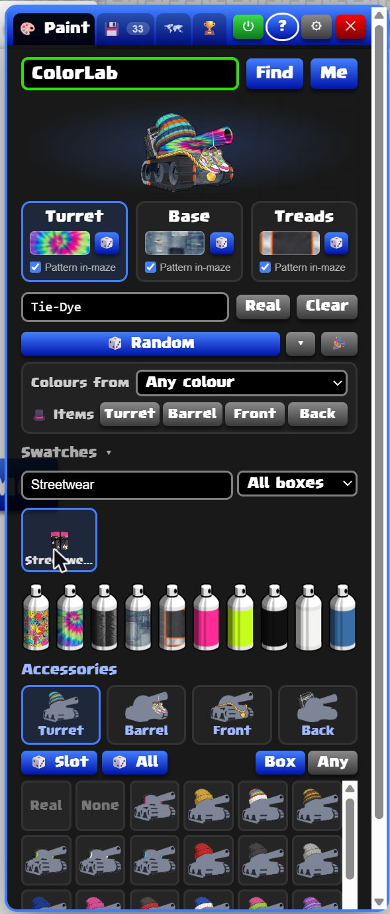
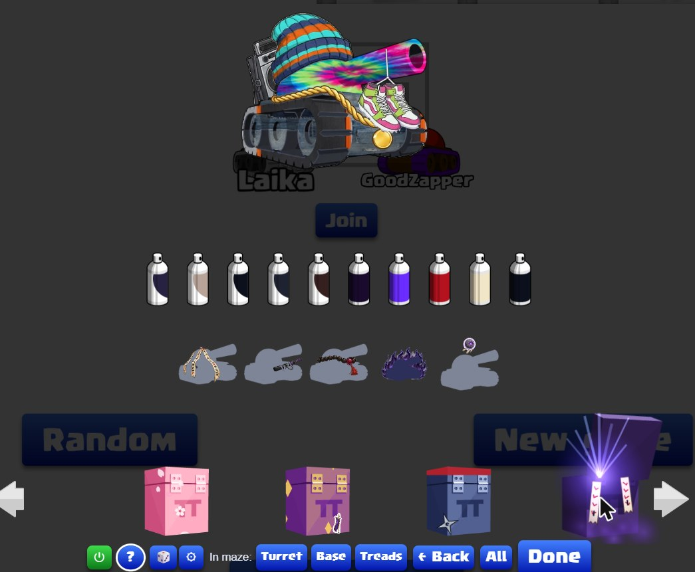
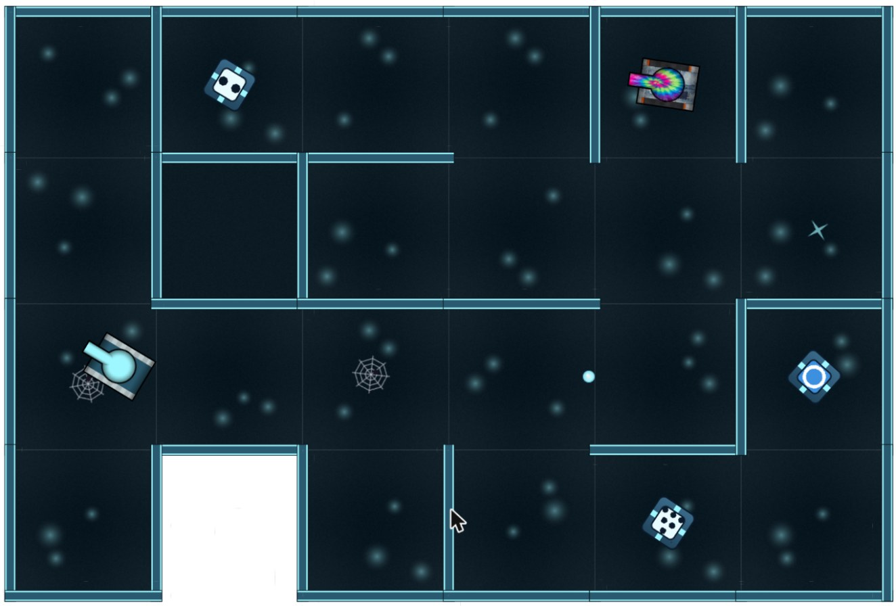
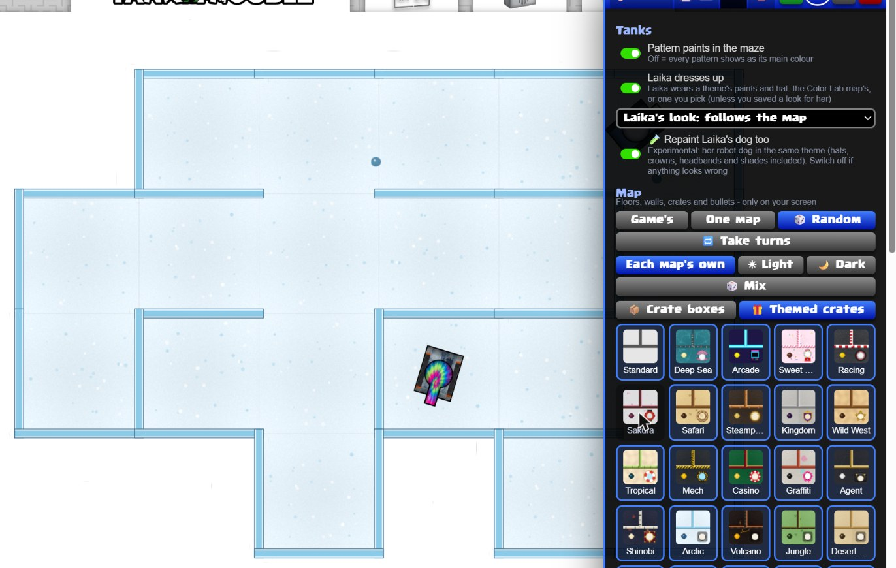

# TankTrouble Color Lab

Made and run by **wazzey**. **Not affiliated with TankTrouble.** Color Lab is an independent, fan-made, cosmetic-only browser extension. TankTrouble, its name and its artwork belong to their owners.

Color Lab lets you reskin TankTrouble your way: custom colours and pattern paints for your tank, extra accessories, themed maps, matching bullets and crates, and new looks for Laika. It is **purely cosmetic**. It gives no advantage in the game, and only **you** see your looks. Other players see the normal game.

## About this project

This started as a personal project. I just wanted to see how different looks would work in the game. Once it grew, I decided to make it public so others can enjoy it too.

- It is **free and not for profit**. There is nothing to buy and no ads.
- I work on it in my **spare time**, so updates and changes come whenever I'm free.
- **AI was used** to help make this, including much of the artwork for the paints and accessories, so don't expect every picture or feature to be perfect.
- **Feedback is very welcome**: ideas, bugs, or anything I could do better. That includes artwork: if a paint or accessory doesn't sit well on the actual tank, or a pattern doesn't look right in the in-game maze, let me know. Reply on the forum thread or open an [issue](https://github.com/wazzey/tanktrouble-color-lab/issues) here.

## For the TankTrouble team

If anything in Color Lab isn't allowed or you'd like something changed or removed, please reply to the Color Lab thread on the TankTrouble forum, send me a message there, or open an [issue](https://github.com/wazzey/tanktrouble-color-lab/issues) here. I'll make the change straight away.

## Want to help with accessories?

Help with accessories would be really welcome, since a lot of the current artwork was made with AI and could look better. If you'd like to make a new item or improve an existing one, see the **[accessory guide](ART-GUIDE.md)**. It has a tank template to draw on, sizes, where items go, tips for using AI, and how to send it in.

## Main features

**🎨 Colour panel (Alt+C)**
Pick any tank by name (or press **Me** for your own), then paint the turret, base and treads separately. Use any hex colour, a pattern paint, or 🎲 for a random one. Pattern paints can show in the maze too. **Swatches** lists every box's paints and items, so you can try anything on.

**💾 Saved looks and presets**
**Save** keeps a look for that tank. Each tank can have up to 10 **presets** to switch between, and each saved tank can be switched on or off. Back everything up with **Settings > Export**.

**🔁 Your real look stays safe**
Your Color Lab look is only on your screen. Your real TankTrouble look, the one other players see, is never changed by it. To change your real look, switch to **Real** in the garage (or pause Color Lab with ⏻), change it as normal, then switch back to **All** or turn ⏻ back on. Your custom look comes straight back, and your new real look is what everyone else sees.

**🏠 In-game garage**
In the game's own garage, **All** shows every paint and item, plus Color Lab's boxes in folders (Original / Custom, sorted by genre). **Real** is your normal garage and saves to your account. There's also a 🎲 random look button and a **Find in garage** search.

**🗺 Map themes**
75 themes for the maze floor, walls and crates, each light or dark, with matching bullets. Pick one, take turns, or get a random one every round. Laika dresses up to match.

**🏆 Hidden achievements**
Color Lab's own achievements, earned in online rounds. Each one unlocks an item, and the hardest also unlock a paint.

## Screenshots

### 🎨 The colour panel

Paint any tank's turret, base and treads, and try on paints and items from every box.



### 💾 Saved looks and presets

Keep a look for each tank, with presets to switch between.


### 🏠 The garage

Every Color Lab box in the game's own garage. Here, a tank in Streetwear items with the Cursed Seal box open.



### 🗺 A themed map in play

Themed walls, floor, crates and bullets, with Laika dressed to match.



### 🗺 Picking a map theme

Choose one map, take turns, or get a random theme every round.



## Download

**The [Releases page](https://github.com/wazzey/tanktrouble-color-lab/releases) of this repository is the only official source of Color Lab. Please download it from here only.**

Each release lists the zip's **SHA-256** checksum, which is also posted in the forum thread. If a friend or another player sends you a copy, check its SHA-256 matches before installing. A copy that doesn't match has been changed and could do things the real one doesn't. Delete it and download from here instead.

> **Copies from other sources are not supported.** I am not responsible for any copy downloaded from another source, or installed without checking that its SHA-256 matches the one listed here.

| Version | File | SHA-256 |
|---|---|---|
| v1.0 | `TankTrouble-Color-Lab-v1.0.zip` | `162a9646ec5084ab65ba70f8587db65319e13e6496419dc72464e4035a33a69c` |

### How to check the SHA-256

**Windows:** open the folder with the zip, click the address bar, type `powershell` and press Enter, then run:

```
Get-FileHash .\TankTrouble-Color-Lab-v1.0.zip
```

**Mac:** open Terminal in the folder and run:

```
shasum -a 256 TankTrouble-Color-Lab-v1.0.zip
```

The long code it prints must match the SHA-256 above exactly.

## Install (Chrome, Edge, Brave, Opera)

1. Unzip it and keep the `TankTrouble-Color-Lab` folder somewhere safe. The browser runs it from there.
2. Go to `chrome://extensions` (or `edge://extensions`, `brave://extensions`).
3. Turn on **Developer mode** (top right).
4. Click **Load unpacked** and choose the `TankTrouble-Color-Lab` folder.
5. Pin it from the puzzle-piece icon, then open or refresh tanktrouble.com and press **Alt+C**.

**First time?** A short built-in tutorial starts on its own. Choose a guided tour of either the **colour panel** or the **in-game garage** (you can take the other one after). Replay it any time from a **?** button or **Settings > Tutorial**.

Your browser may warn about extensions in Developer mode. That's normal for anything installed this way.

**Updating:** copy the new files over your old folder, press reload on the extension, then refresh TankTrouble. Your looks are kept.

**Getting told about updates:** click **Watch → Custom → Releases** at the top of this page (you need a free GitHub account), or keep an eye on the forum thread. Each release lists what's new and its SHA-256.

## Supported browsers

- **Works on:** Chrome, Edge, Brave and Opera on a computer (Windows, Mac or Linux).
- **Not supported:** Firefox, Safari, and phones or tablets.

## Shortcuts

| Keys | What it does |
|---|---|
| **Alt+C** | Open or close the Color Lab panel |
| **Alt+V** | Refresh your logged-in tanks' looks |

You can change these at `chrome://extensions/shortcuts`.

## What's in it

- Custom colours (any hex colour) and pattern paints for turret, base and treads
- Custom pattern paints also show on your tank in the in-game maze, not just in the garage
- Hundreds of extra accessories in genre folders in the garage (Original / Custom)
- 75 map themes, each light or dark, with matching bullets, crates and shields
- Multi-coloured bullets that spin and flip on every bounce
- Laika dresses up to match each map
- Hidden achievements that unlock extra items and paints
- Party mode, random looks, saved presets and backups

## What it changes

Everything is visual and only on your screen:

- **Tanks:** colours, paints and accessories on your tanks and on any tank you give a custom look
- **Garage:** extra boxes, folders and a search panel
- **Maps:** floor, walls, crates and decorations can use a map theme
- **Bullets:** colours can match the map. The laser and aim lines are recoloured so they stay visible on every map
- **Laika:** Laika's tank and dog can dress up to match the map
- **Achievements:** an extra tab with Color Lab's own hidden achievements, separate from the game's

**What other players see:** the normal game. Color Lab looks are never sent to the game's server. The only exception is the garage's **Real** mode (and the dice / "Find in Real" buttons), which changes your actual tank exactly like the game's own garage does, and only with items you already own.

## Unreleased box

In the garage's **All** mode you can also see the never-released box and its paints and items. Its contents list comes from the **IronVault** garage simulator, and the items themselves load from TankTrouble's own game files (its original box picture isn't used; it shows a plain placeholder). It's purely cosmetic and only on your screen: you can't actually get or equip these items on your account, and nothing about it is sent to TankTrouble.

## FAQ

**Can I get banned for using it?**
Color Lab is purely cosmetic. It only changes how things look on your own screen, so it shouldn't count as cheating in any way, and it gives no advantage in the game.

**How do I change my real look without losing my custom one?**
In the garage, switch to **Real** (or pause Color Lab with ⏻), change your tank as normal, then switch back to **All** or turn ⏻ on again. Your Color Lab look is kept the whole time and is never sent to TankTrouble, so other players only ever see your real look.

**Can other players see my look?**
No. Only you see your Color Lab looks. Other players see your normal tank, unless you use the garage's **Real** mode, which changes your actual tank with items you own.

**Does it need my password or account?**
No. It never reads, keeps or sends your password, and there's no Color Lab account.

**Will I lose my looks when I update?**
No. Copy the new files over your old folder and your looks are kept. You can also back them up with **Settings > Export**.

**Something looks wrong or doesn't fit the tank. What should I do?**
Let me know on the forum thread or open an [issue](https://github.com/wazzey/tanktrouble-color-lab/issues), ideally with a screenshot.

## Known issues

- Some AI-made items and paints may not sit perfectly on every part of the tank, or may look different in the maze than in the garage.
- If your look doesn't show straight away, press **Alt+V** to refresh it.
- The never-released box shows a plain placeholder picture instead of its original art.

## Privacy

- Runs **only on tanktrouble.com**. It can't see other websites, tabs, history, cookies, passwords or downloads.
- Browser permissions: **storage** (to save your looks) and **scripting** (so the toolbar button / Alt+C can open the panel).
- It reads TankTrouble's own game messages in the page to recolour tanks and track achievements. Your login passes through the game normally. Color Lab never reads, keeps or sends your password.
- **No tracking, no analytics, no account.** Nothing about you is collected or sent anywhere.
- Everything it saves stays **on your own computer**:
  - your looks, presets and settings;
  - the usernames of tanks you give a custom look;
  - your achievement progress;
  - a backup copy in TankTrouble's site storage;
  - a picture cache.
- The zip includes `WHAT IT CHANGES AND PRIVACY.txt` with the full details.

### Removing everything

1. Optional: **Settings > Export** to keep a copy of your looks.
2. Remove the extension at `chrome://extensions`.
3. Clear tanktrouble.com's site data. Click the padlock next to the address, then go to **Site settings > Delete data**.

## Credits

- Garage box data, including the never-released box's contents list: the **IronVault** garage simulator.
- Item and paint artwork for Color Lab's own boxes was made for this project, with the help of AI.
- Some items are reskins of TankTrouble's own items (for example capes, hazmat hoods, wings and medals). They are recoloured on your screen from the game's own artwork while you play. None of the game's artwork is included in this download.
- TankTrouble and its original artwork belong to their owners.

## Copyright

© 2026 wazzey. All rights reserved. You're welcome to download and use Color Lab for free, but please don't copy, re-upload or redistribute it, or publish modified versions, without permission. Share the link to this page instead.

TankTrouble, its name, logo, artwork and characters (including Laika) belong to their owners. Color Lab doesn't include any of the game's artwork; it only changes how the game looks on your own screen while you play.

## Disclaimer

Color Lab is provided "as is", for fun, without any warranty. It is a fan project and is not made, endorsed or supported by TankTrouble. You use it at your own risk.

The only official source is the [Releases page](https://github.com/wazzey/tanktrouble-color-lab/releases) of this repository. I am not responsible for copies obtained from anywhere else, copies that have been modified, or copies installed without checking that their SHA-256 matches the one published here.
