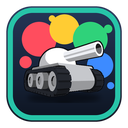
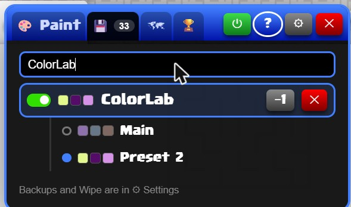
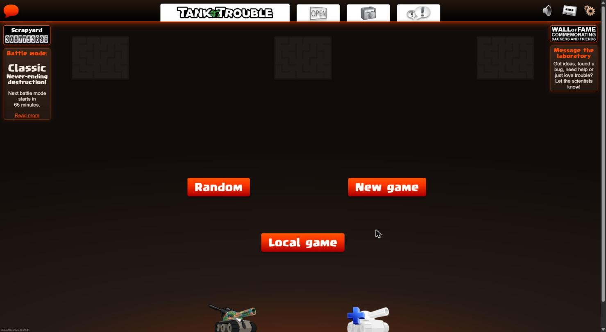
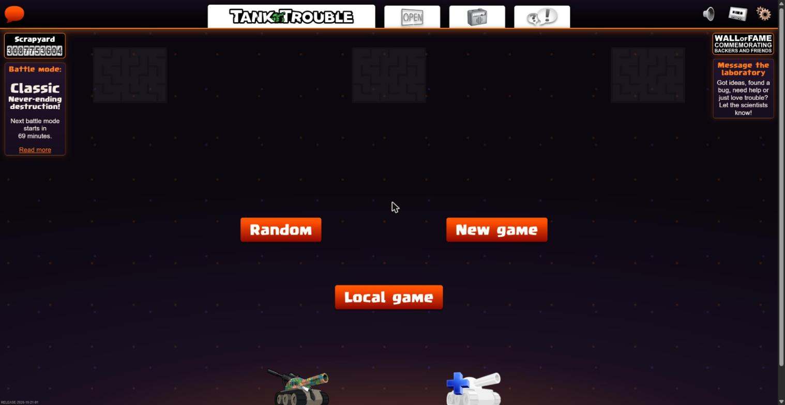
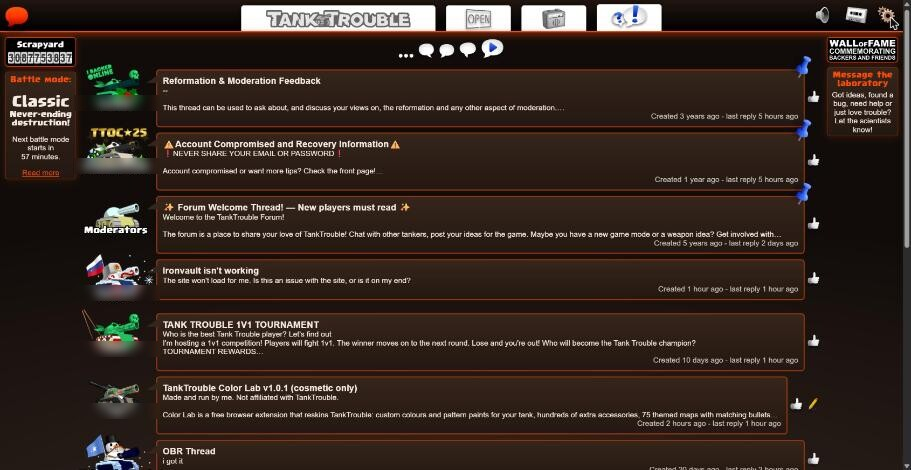
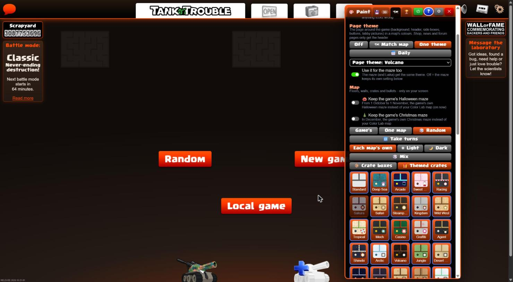

# TankTrouble Color Lab

**Custom colours, paints, items, map themes and page themes for TankTrouble.** 
Cosmetic only · Free · No ads · No account · Open source

[**Install**](#install) · [**What's new**](https://github.com/wazzey/tanktrouble-color-lab/releases/latest) · [**Features**](#features) · [**Screenshots**](#screenshots) · [**FAQ**](#faq) · [**Privacy**](PRIVACY.md) · [**Development**](#development)

> Made and run by **wazzey**. **Not affiliated with TankTrouble.** A fan-made extension that changes how the game looks on your own screen and gives no advantage in the game. Only you and other Color Lab users see your looks; everyone else sees the normal game.

---

## Install

### Chrome Web Store (recommended)

One click, and it **updates by itself**. The listing is in review; the **Add to Chrome** link goes here once it's approved.

### From GitHub

1. Download `TankTrouble-Color-Lab-v<version>.zip` from the [**latest release**](https://github.com/wazzey/tanktrouble-color-lab/releases/latest) (not "Source code").
2. Unzip it and keep the `TankTrouble-Color-Lab` folder somewhere safe. The browser runs it from there.
3. Open `chrome://extensions` (or `brave://extensions`, `edge://extensions`) and turn on **Developer mode**.
4. Click **Load unpacked** and choose the `TankTrouble-Color-Lab` folder.
5. Open tanktrouble.com and press **Alt+C** (**Option+C** on a Mac).

A short tutorial starts the first time. This copy doesn't update by itself; Color Lab tells you when a new version is out. To update, copy the new files over the old folder, press reload on the extension and refresh TankTrouble. Your looks are kept.

Copies older than v1.4.3 no longer work online (look sharing, the online list and messages).

<b>Moving from the GitHub zip to the Chrome Web Store</b>

 

Do it **in the same browser** and your looks come with you:

1. Optional but safest: **Settings > ⬇ Export backup** in the old copy.
2. Remove the old copy at `chrome://extensions`.
3. Add Color Lab from the Chrome Web Store, then refresh TankTrouble.

Saved tanks and looks, colours, settings, themes and achievement progress are restored from the backup Color Lab keeps in TankTrouble's own site storage. Your account's key is made from your account's details, so your tanks stay proven. Moving to a **different browser** or computer? Log in and your saved looks and achievements come back from **Backup** by themselves. **⬇ Export backup** and **⬆ Import** still move everything else (settings, themes, and looks you gave other players' tanks).

Don't keep two copies switched on in the same browser: only one runs, and the other gets in its way.

<b>Checking a download</b>

 

Official copies come only from the Chrome Web Store and this repository's [Releases page](https://github.com/wazzey/tanktrouble-color-lab/releases). Each release lists its zip's SHA-256, built from the source here by GitHub Actions. If someone sends you a copy, check it matches:

- **Windows** (PowerShell in the zip's folder): `Get-FileHash .\TankTrouble-Color-Lab-v<version>.zip`
- **Mac** (Terminal in the zip's folder): `shasum -a 256 TankTrouble-Color-Lab-v<version>.zip`

---

## Features

|                          |                                                                                                                                                                                   |
| ------------------------ | --------------------------------------------------------------------------------------------------------------------------------------------------------------------------------- |
| 🎨 **Colour panel**      | Paint any tank's turret, base and treads with any hex colour or pattern paint, and try on items from every box. **Alt+C** opens it.                                               |
| ☁ **Backup**             | Your saved looks and achievements are kept for your account, so they come back on any computer you log in on.                                                                     |
| 💾 **Saved looks**       | Up to 10 looks per tank, switched in one click from the garage's **💾 Looks** button. Back everything up with **Settings > Export**.                                              |
| 🏠 **In-game garage**    | **All** shows every paint and item plus Color Lab's own boxes, in folders. **Real** is the normal garage and saves to your account. 🎲 random look and **Find in garage** search. |
| 🗺 **Map themes**         | Themes for the maze floor, walls and crates, light or dark, with matching bullets. Laika dresses up to match.                                                                     |
| 🌙 **Page themes**       | The whole TankTrouble page in any map's colours, plus Dark, Halloween, Christmas and Easter. Forum, news and shop too.                                                            |
| 🔗 **Look sharing**      | Color Lab players see each other's looks live in the lobby, garage and maze. Only for tanks proven to be yours.                                                                   |
| 🟢 **Who's online**      | How many Color Lab players are online and, for those who choose to show themselves, who, and whether they're in the lobby, a queue or an online game.                             |
| 🏆 **Achievements**      | Earned in online rounds, each unlocking an extra item or paint.                                                                                                                   |
| 💬 **Message Color Lab** | Send ideas or bugs with screenshots from the lobby, and read the replies there.                                                                                                   |
| 👁 **Always visible**     | Mines, missiles, lasers and bullets get a colour that stands out on every map.                                                                                                    |
| 🔌 **Go offline**        | One switch stops all contact with Color Lab's server. Everything on your screen keeps working.                                                                                    |

**Your real look stays safe.** A Color Lab look never changes what players without Color Lab see. To change your real tank, switch the garage to **Real**, change it as normal, then switch back to **All**.

| Keys                          | What it does                        |
| ----------------------------- | ----------------------------------- |
| **Alt+C** (Mac: **Option+C**) | Open or close the Color Lab panel   |
| **Alt+V** (Mac: **Option+V**) | Refresh your logged-in tanks' looks |

Change them at `chrome://extensions/shortcuts`. Works on Chrome, Brave, Edge, Opera and Vivaldi on Windows, Mac and Linux; not on Firefox, Safari, phones or tablets.

---

## Screenshots

**🎨 The colour panel**: paint any tank and try on paints and items from every box.

**💾 Saved looks**: several looks for each tank.

**🏠 The garage**: Color Lab's boxes in the game's own garage.

**🗺 A themed map in play**: walls, floor, crates and bullets, with Laika dressed to match.

**🗺 Picking a map theme**: one map, take turns, or a new theme every round.

**🌙 Page themes**: the whole page in a map's colours (here, Volcano), with the maze to match if you like.

<b>More: seasonal themes, the forum, and the settings</b>

 

---

## FAQ

**Can I get banned for using it?**
Color Lab is purely cosmetic. It only changes how things look on your own screen and gives no advantage in the game.

**Can other players see my look?**
Only players who also use Color Lab (switch this off in **Settings > Look sharing**). The garage's **Real** mode is the only thing that changes your actual tank, using items you already own, exactly like the game's own garage.

**Does it need my password or an account?**
No. It never reads, keeps or sends your password, and there's no Color Lab account.

**Do my looks follow me to another computer?**
Yes. Log in on any computer with Color Lab and your saved looks and achievement progress come back by themselves. They're kept on Color Lab's server, and only your account's own key can read or change them. An account that has never messaged the TankTrouble laboratory proves the tank first on a new computer (Color Lab changes one thing on it for about a second). Switch it off in **Settings > Backup**.

**What does it send, and who can see it?**
All of it is in the [privacy policy](PRIVACY.md), including what the author can see. The server's code is in [`server/`](server), so you can check.

**Something looks wrong or doesn't fit the tank.**
Tell me on the [forum thread](https://tanktrouble.com/forum?id=475180) or open an [issue](https://github.com/wazzey/tanktrouble-color-lab/issues), ideally with a screenshot.

<b>Known issues</b>

 

- Some AI-made items and paints don't sit perfectly on every part of the tank, or look different in the maze than in the garage.
- If your look doesn't show straight away, press **Alt+V** to refresh it.
- The never-released box shows a plain placeholder picture instead of its original art.

---

## For the TankTrouble team

If anything in Color Lab isn't allowed, or you'd like something changed or removed, reply to the [Color Lab thread](https://tanktrouble.com/forum?id=475180) or open an [issue](https://github.com/wazzey/tanktrouble-color-lab/issues) and I'll change it straight away.

## About

- **Free and not for profit.** Nothing to buy, no ads. Made in my spare time.
- **AI helped make it**, including much of the artwork for the paints and accessories.
- **Want to help with accessories?** See the [accessory guide](ART-GUIDE.md).
- In the garage's **All** mode you can also see the never-released box. Its contents list comes from the **IronVault** garage simulator and its items load from TankTrouble's own game files. It's only on your screen; nothing about it is sent to TankTrouble.
- Some items are reskins of TankTrouble's own items, recoloured on your screen from the game's artwork while you play. None of the game's artwork is in this repository or the download.

---

## Development

| Folder                                 | What it is                                                                                                                                                                                                                                                                                                                                                                                                |
| -------------------------------------- | --------------------------------------------------------------------------------------------------------------------------------------------------------------------------------------------------------------------------------------------------------------------------------------------------------------------------------------------------------------------------------------------------------- |
| [`extension/`](extension)              | The extension. `content.js` runs in the page and starts every feature in order; [`core/`](extension/core) holds the features (storage, look sharing, the game hooks, the garage, the panel and so on) and [`content/`](extension/content) the boxes, maps, achievements and art. `bridge.js` passes messages to `background.js`, which talks to the server, and with `vault.js` makes each account's key. |
| [`server/`](server)                    | The look server: a Cloudflare Worker with a D1 database. Pushing to `main` deploys it. Secrets live in Cloudflare (`npx wrangler secret list`), never here.                                                                                                                                                                                                                                               |
| [`scripts/build.js`](scripts/build.js) | Builds the extension with Bun.                                                                                                                                                                                                                                                                                                                                                                            |

Install [Node](https://nodejs.org) 22+, then `npm ci`. That installs the pinned Bun, which does the formatting, linting and building:

| Command             |                                                                                                                                                                  |
| ------------------- | ---------------------------------------------------------------------------------------------------------------------------------------------------------------- |
| `npm run build`     | `dist/TankTrouble-Color-Lab/` (for Load unpacked), its zip and the Web Store zip. The same commit always gives the same zip.                                     |
| `npm run build:dev` | The DEV build: the owner's tools, readable code with source maps, and "(DEV)" in its name. It goes to `DEV_OUT` from `.env` (see `.env.example`) or `dist/dev/`. |
| `npm run dev`       | The DEV build again on every change.                                                                                                                             |
| `npm run lint:fix`  | Fixes and formats everything. Run it before every commit.                                                                                                        |
| `npm run check`     | What CI runs: formatting, lint and the build.                                                                                                                    |

Modules only define things when they load. What a feature does at start-up is in its `start…()` function, and `content.js` calls those in a fixed order. The `content/` modules only add items to shared tables and never import from `core/`. Code that only belongs in the owner's build sits behind `DEV_BUILD`, which the build sets to `false` for the public build, so that code isn't in it.

**Releasing:** raise `version` in `extension/manifest.json` and push. CI checks and builds every push; for a new version it also creates a draft release with the zip and its SHA-256. Write the title and notes there and publish. Publishing uploads the same build to the Chrome Web Store, and the server posts it on the forum.

## Licence

© 2026 wazzey. Color Lab is free software under the [GNU General Public License v3.0](LICENSE): you may use, study, share and change it, and anything you share that's based on it must be under the same licence, with its source. Please give a modified version its own name, so players can tell it apart from the official one.

TankTrouble, its name, logo, artwork and characters (including Laika) belong to their owners. Color Lab is a fan project, not made, endorsed or supported by TankTrouble, and comes without any warranty.
